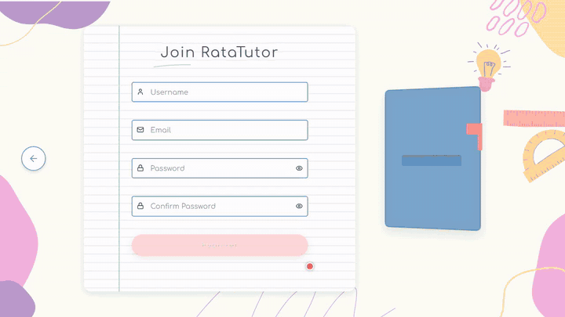
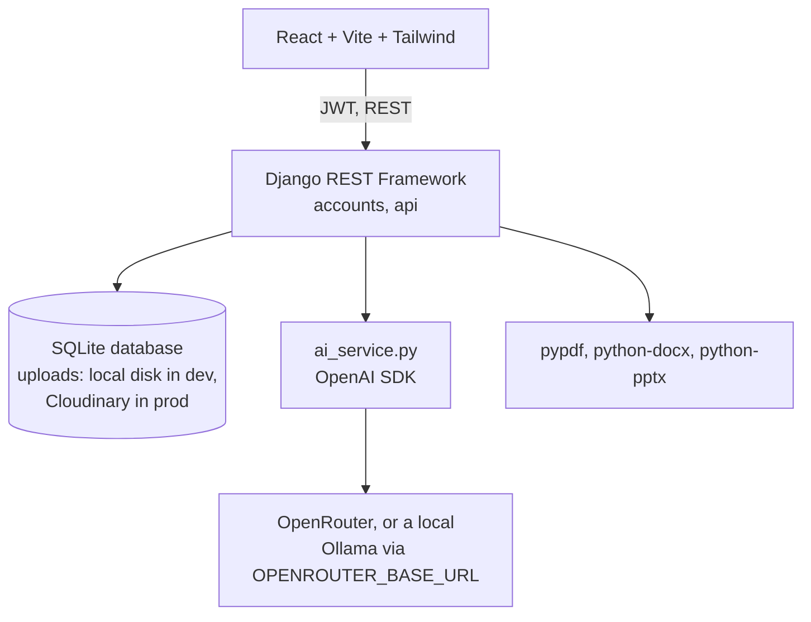

# RataTutor

Study assistant: turns notes and documents into flashcards, summary notes and quizzes, with an AI tutor per material.



*The real app on a local stack (Django on localhost, Vite dev server) with a local model, qwen3:14b through Ollama, not OpenRouter. Waiting stretches are sped up and labelled with the speed in the corner; the red dot is a pointer overlay added for the recording.*

## My part

A five-person university web engineering project that I kept maintaining afterwards. By author name, about 135 of the 265 commits are mine (121 under my name, about 15 under my GitHub login); teammates and Dependabot hold the rest. What I can point to in the history:

- The initial Django, React, Vite and Tailwind integration, the Dockerfile and entrypoint, and the Render deployment, including the catch-all redirect that serves the React app from Django.
- Backend validation and serializers, password reset by email, and Cloudinary storage split from development storage.
- The streak logic, moved fully to the backend, with logins counting as activity.
- The AI service: the switch from the Google Gemini SDK to the OpenAI SDK on OpenRouter, conversation summaries, and the flashcard, note and quiz generators.
- Login, register, material, trash and explore screens, and the dashboard's centralised data fetch.
- Later maintenance: the `pypdf` swap to clear a Dependabot alert, and the `OPENROUTER_MODEL` and `OPENROUTER_BASE_URL` settings below.

Team: Nikka Joie Mendoza, Mc Clareenz Zerrudo, Shaira Joy Macale, Vince Quinañola and me.

**Proof:** 42 REST routes, flashcard sets and quizzes of 1 to 20 items, and on a local qwen3:14b (16 GB GPU) a ten-card set, a ten-question quiz and a chat answer each took roughly 10 to 25 seconds on notes of about 1 KB.

The hosted copy is offline: the free-tier host suspended its services in October 2026. Everything runs locally.

## What it is and why

Upload PDF, DOCX, PPTX or TXT files to a study material, then generate flashcards, multiple-choice quizzes and summary notes from its text, and chat with a tutor that belongs to that material and keeps its history. Materials can be pinned, trashed, made public or copied from another user, and a study streak is tracked on the backend.

## What was hard

- **A retired model took every AI call down.** The model id was a literal repeated in eight calls in `backend/api/services/ai_service.py`. OpenRouter removed that model and every call failed. The id is now `OPENROUTER_MODEL` and the endpoint is `OPENROUTER_BASE_URL`, so a retirement is an environment change, and a local Ollama works with no OpenRouter account.
- **Chat context without a vector store.** A conversation of six messages or fewer sends everything. A longer one sends a stored summary plus the last four messages, and the summary is regenerated by a second model call. The material's text is included only when the prompt has a trigger word such as "document" or "according to": under 2,000 characters it is sent whole, otherwise the first three 1,000-character chunks, unranked (ranking by relevance is not done).
- **Untrusted model JSON.** The model's reply is parsed and validated before anything is saved, with a fallback title when the title is unusable.

## Architecture



## Run it

```bash
git clone https://github.com/Exalt24/RataTutor.git && cd RataTutor && npm install
cd backend && python -m venv venv && source venv/bin/activate && pip install -r requirements.txt && cd ..
# create backend/.env and frontend/.env (values in docs/SETUP.md), then:
cd backend && python manage.py migrate && cd .. && cd frontend && npm install && cd ..
npm run dev     # Django on :8000, React on :3000, with a development test user
```

Environment values, the local-model settings, other ports, Docker and troubleshooting are in [docs/SETUP.md](docs/SETUP.md). Routes are in [docs/API.md](docs/API.md) and screenshots in [docs/SCREENSHOTS.md](docs/SCREENSHOTS.md).

## Tests

None yet. `backend/api/tests.py` and `backend/accounts/tests.py` are the empty files Django generates, and there is no CI workflow.

## Limits and not done

- No automated tests and no CI.
- Against OpenRouter, the AI features work only while the configured model id is still listed there.
- Local model: Ollama's default context window was 4096 tokens, so longer documents need a larger `num_ctx`, which I have not tested.
- Chunk selection for long materials is the first three chunks, not the most relevant ones.

## Stack

Django, Django REST Framework, SimpleJWT, SQLite, Cloudinary, React, Vite, Tailwind CSS, the OpenAI Python SDK, pypdf, python-docx, python-pptx, Docker.

## License

MIT, see [LICENSE](LICENSE).
