# Screenshots

  <table>
    <tr>
      <td align="center">
        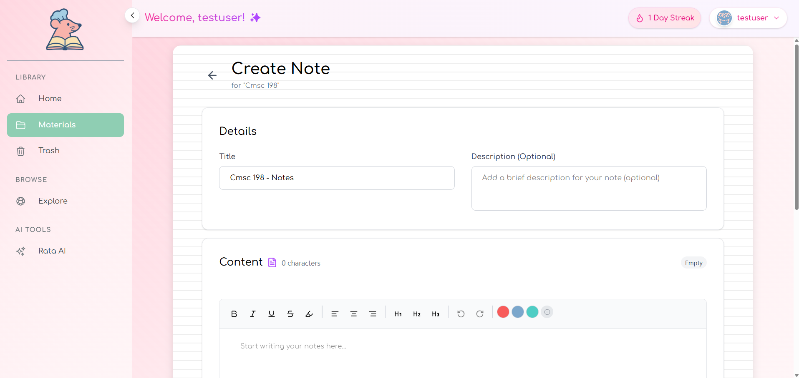
         
        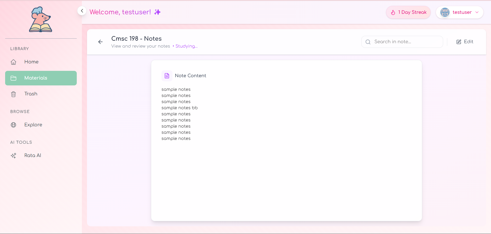
         
        <em>Upload notes</em>
      </td>
      <td align="center">
        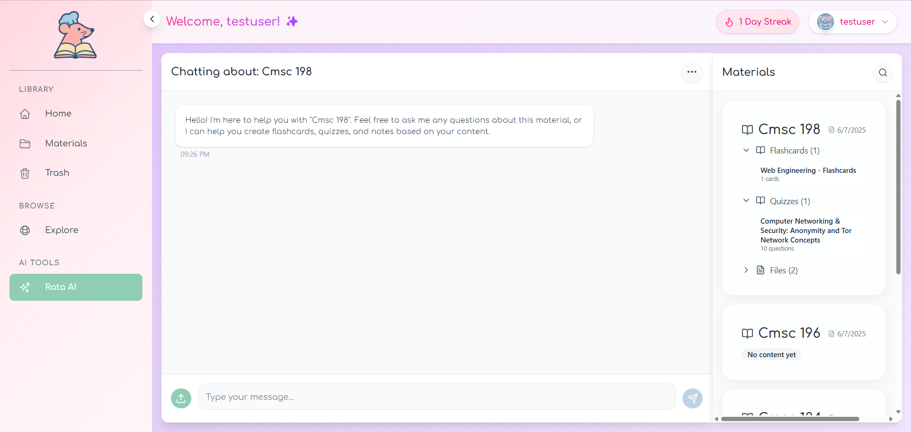
         
        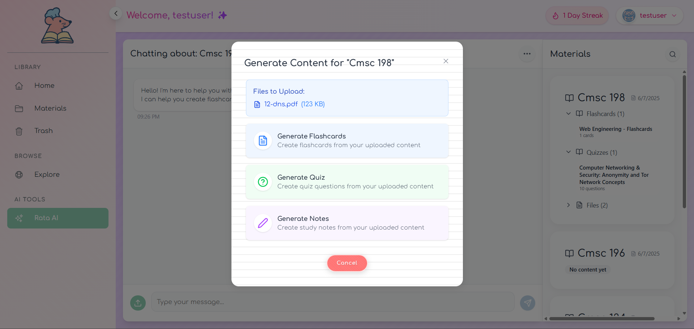
         
        <em>AI chat</em>
      </td>
    </tr>
    <tr>
      <td align="center">
        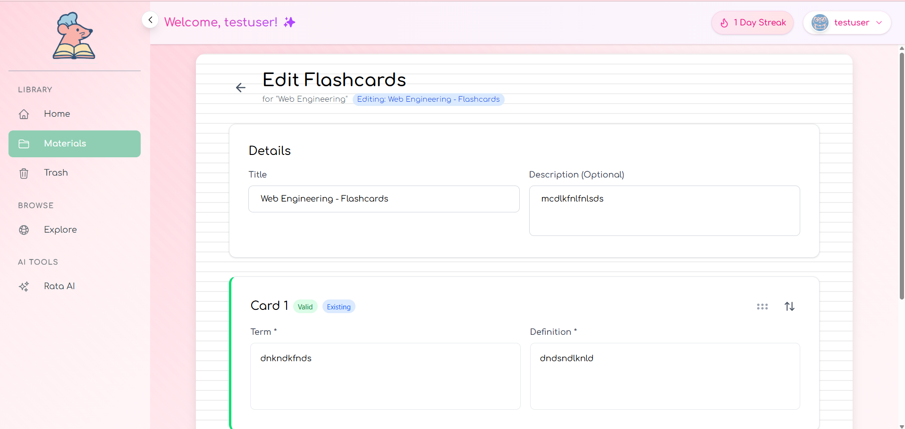
         
        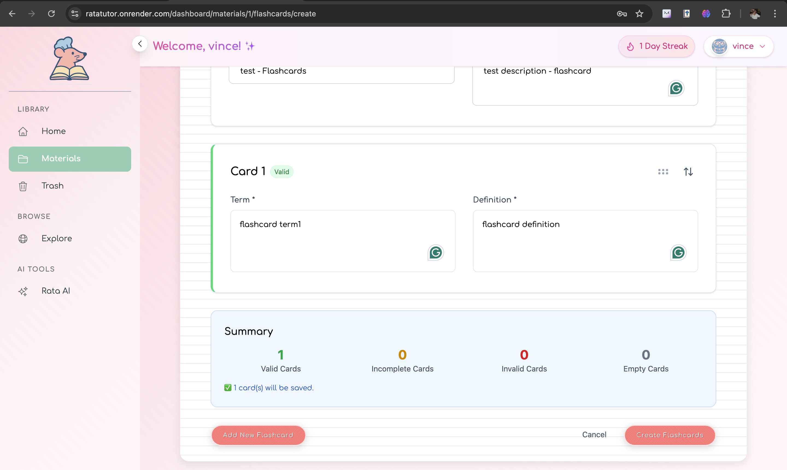
         
        <em>Flashcards</em>
      </td>
      <td align="center">
        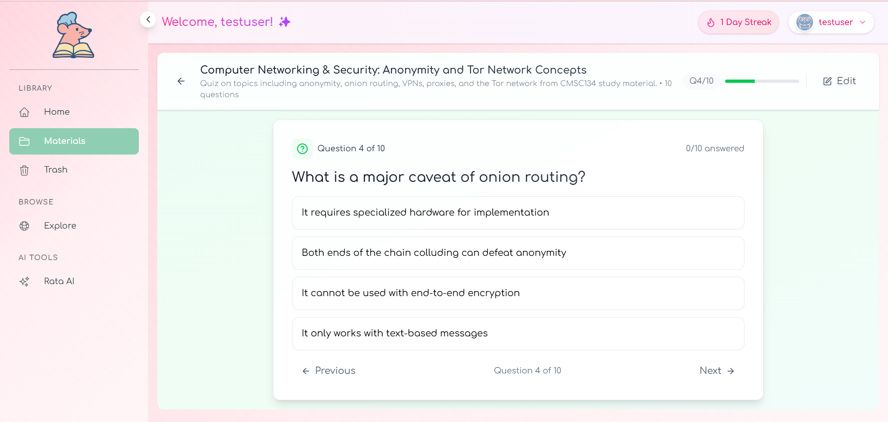
         
        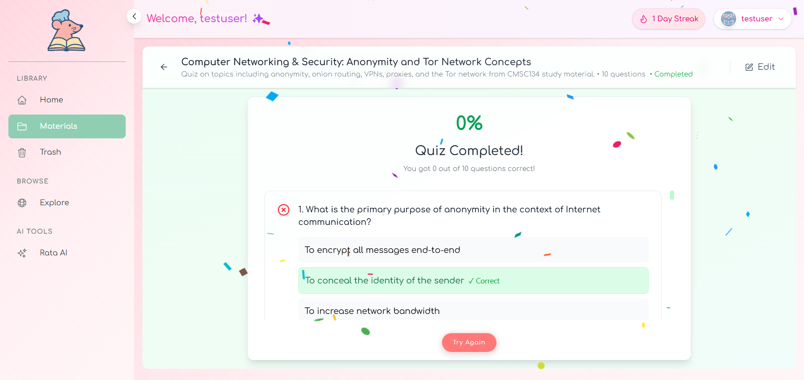
         
        <em>Quizzes</em>
      </td>
    </tr>
    <tr>
      <td align="center">
        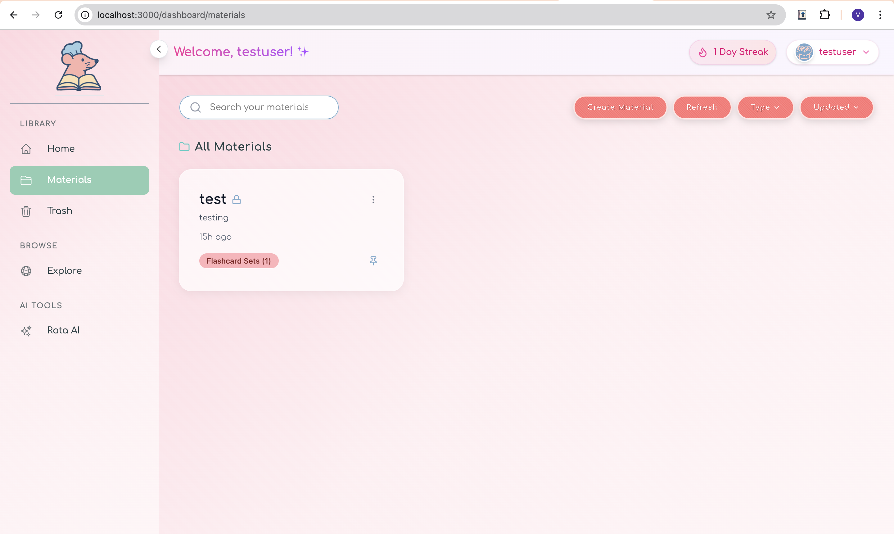
         
        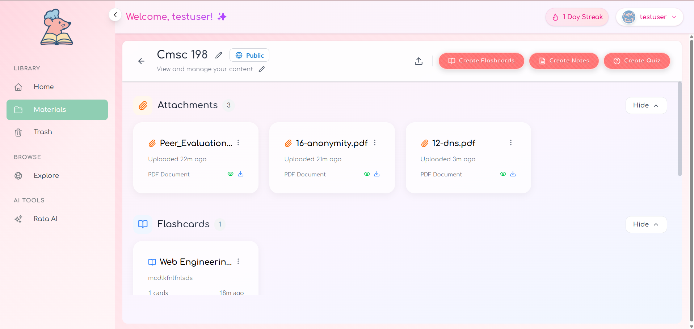
         
        <em>Material dashboard</em>
      </td>
      <td align="center">
        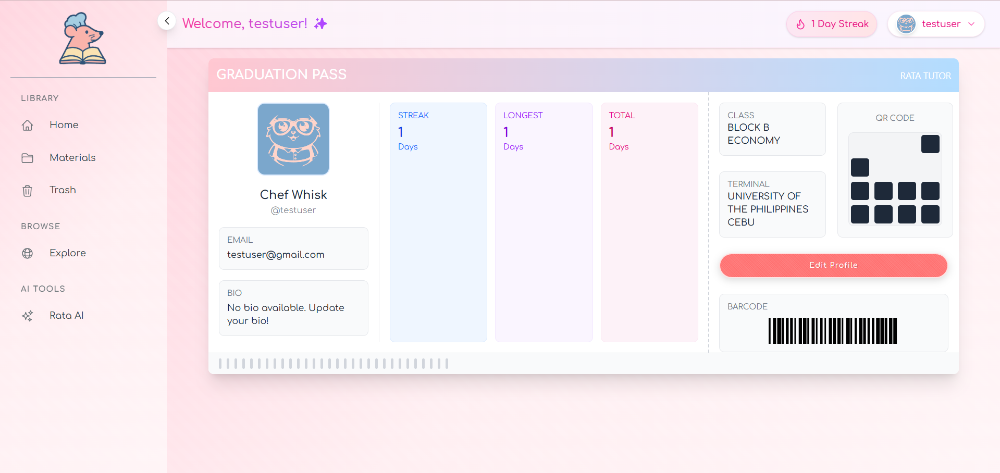
         
        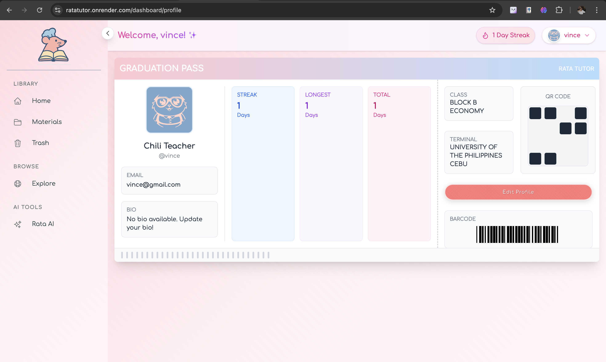
         
        <em>Profile</em>
      </td>
    </tr>
  </table>

